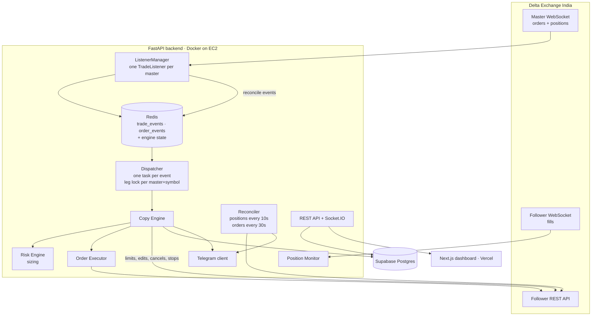

# Mirror Engine — High-Level Design

Mirror Engine copies a master account's trading on Delta Exchange India to its follower accounts, sized to each follower, in about 1–2 seconds, and then keeps checking that the followers still match.

Reflects the code at commit `5982fe8` (24 Nov 2026). Exact rules, keys and timers are in the [LLD](lld.md).

---

## 1. Shape

| Component | Responsibility |
|---|---|
| **TradeListener** (`core/trade_listener.py`) | One per active master. Reads the master's order and position updates; emits **fill events** (market orders), **order events** (resting limits and stops placed / edited / cancelled, a limit filled, a stop fired) and periodic **reconcile events**. Every event carries the master's account id. |
| **Dispatcher** (`main.py`) | Pops events from Redis and runs each as its own task. Events for the same master and symbol take a shared **leg lock**, so they run one after another; different legs run in parallel. |
| **Copy Engine** (`core/copy_engine.py`) | Decides what each follower must do for an event and does it. Also hosts the reconciler and protection sync. |
| **Risk Engine** (`core/risk_engine.py`) | Follower size for a given master quantity: auto ratio, multiplier, fixed or capital %. Fail-closed. |
| **Order Executor** (`core/order_executor.py`) | Places a follower's copy of a market fill: a limit at the master's price, then market for any remainder. |
| **Position Monitor** (`core/position_monitor.py`) | Checks positions as updates arrive; raises in-app mismatch rows and the orphan alert. |
| **Order Ledger** (`core/order_ledger.py`) | Redis records the engine consults: what happened to each master order per follower, hands-off marks, master peaks. |
| **REST API / Socket.IO** (`api/`, `websocket/`) | Dashboard data, account management, comparison reports, auth. |
| **Telegram client** (`services/telegram_client.py`) | Alert wording, per-owner routing, once-per-episode de-duplication. |

---

## 2. Groups, tenants and isolation

* **Owner** (a user) → up to **5 masters** → each with up to **2 followers**. A follower names its master in `accounts.master_id`.
* **Every event names its master**, and the engine acts only on followers whose `master_id` *is* that master. A follower is sized only against its own master's position and balance. A follower whose master was deleted follows nobody and is never traded.
* An admin is exempt from owner scoping in the API (sees and manages every tenant); the engine's isolation does not depend on the API at all.
* All shared state is keyed per master or per follower: caches, two-pass confirmation, leg locks, hands-off marks, peaks.

> **Why this is strict.** On 24 Nov 2026 a cancel on one master, with no follower copy on record, fell back to "every follower in the system" and sized another group's follower against the wrong master: 2602 lots closed. Isolation is now enforced at each selection point and covered by tests.

---

## 3. How a master action reaches a follower

### 3.1 Market order (fill event)
1. The listener sees the fill and pushes `{master order id, how much has filled so far}`.
2. The engine **claims** the not-yet-copied part of that order in the database (atomically), so a repeated or out-of-order update copies nothing twice.
3. Per follower:
   * **Entry** — copy this piece's share of the order, capped at what keeps the follower at its share of the master's live position.
   * **Exit, filled in one go** — close the follower down to its share of what the master still holds.
   * **Exit, filled in pieces** — each piece sells only its share, never taking the follower below its share; the last piece to a flat master closes whatever is left.
4. The Order Executor places it: limit at the master's price, then market.

### 3.2 Resting limit order (order event)
* **Place** → the follower gets the same order at the same price, sized as part of the master's whole ladder on that strike. A part-filled master order is still resting and is sized by what is left.
* **Edit** → the follower's copy is edited; a failed edit cancels the old copy before re-placing.
* **Cancel** → the follower's copy is cancelled, found by an id tied to the master's order. Then a **settle** closes the follower down to its share if the master abandoned an exit — counting the follower's other resting exits first.
* **Master's limit fills** → the follower's copy gets 5s to fill at the same price, then the remainder goes at market. A partial master fill keeps the copy queued. When the master's order is final, **confirm-copy** checks each follower got its share and tops up any shortfall.

### 3.3 Stop-loss / take-profit
* Each follower gets its own copy, placed **`tp_sl_offset` (default 50) beyond the master's trigger** on the side away from the current price, so the master always exits first. If the price can't be read, the copy goes exactly on the master's trigger — never in front of it. *(Temporary desk rule since 24 Nov 2026.)*
* When the **master's stop fires**, the follower's leg is marked **hands-off**: its own stop is left to close it, and nothing is forced.
* The order sweep **places a missing follower stop** and **cancels an orphaned one**.

---

## 4. The safety net (reconciler)

Live copying can fail for reasons it cannot control — a margin rejection, a WebSocket gap, a limit that never fills. So the engine also compares **state**:

* **Every 10s per master** it compares each follower leg with its target (its share of the master's position) and opens a missing leg, trims an oversized one, tops up an undersized one, or closes one the master has left.
* **Every 30s** it re-pushes the master's resting limits (idempotent — only a missing copy is placed) and syncs protection.

What keeps it from doing harm:

| Guard | Why |
|---|---|
| **Two sightings** before acting | a book read mid-trade looks wrong for one pass |
| **Deadband** — under 5% or 1 lot is ignored | the ratio moves with balances; acting on noise churns |
| **No late entries** — a missing leg is opened only if the master's last *entry* on it is under 3 minutes old; an exit never counts as an entry | buying in late at a new price is worse than staying out; it alerts instead |
| **Hold while the master is working an order or reducing** (below his peak) | his own order settles it; topping up into an unwind is wrong |
| **Hands-off** after the master's stop fired | the follower's own stop closes it |
| **Last look** — re-read the follower inside the leg lock before placing | a live copy may have just changed the leg |
| **Leg lock**, skip if busy for 5s | never act alongside another writer on the same leg |

Asymmetry throughout: **reducing** a follower on stale information is self-correcting; **adding** is not. Opens and top-ups are the most guarded actions.

---

## 5. Concurrency model

* Each event is its own asyncio task; there is no single queue worker to block on.
* The **leg lock** `(master, symbol)` serialises everything that can trade a follower's leg: live fill and order events, the reconciler's corrections, confirm-copy.
  * **Live events wait up to 30s** for the lock — longer than one copy takes (limit, 5s wait, market, confirm) — and only run unlocked if something is genuinely stuck, so a master trade is never dropped.
  * **The reconciler waits 5s** and skips the leg if busy; the next pass retries.
* **Idempotency** by master order id: the per-order claim for fills, `ordermap` for resting copies, a `client_order_id` on every placed order, and once-per-order markers for escalation and confirm-copy.

---

## 6. Alerting

* Routine copies are silent; Telegram carries only what needs a look (see README). Mismatch rows also appear in the in-app feed.
* Alerts are once per episode (Redis-backed, survives a restart) and re-arm when the problem clears.
* Each owner's alerts go to their own chat (`TELEGRAM_CHAT_ROUTES`).
* A daily report compares master and follower fills from the exchange and posts the result at 23:45 IST.

---

## 7. Deployment

| Piece | Where |
|---|---|
| Frontend (Next.js) | **Vercel**, deploys on push to `main` |
| Backend (FastAPI) + Redis | **Docker on EC2**; backend bind-mounted with `uvicorn --reload`, so a `git pull` restarts it in ~3s |
| Database + auth | **Supabase** (Postgres, Mumbai) |
| Monitoring | `ops/watchdog.sh` (on-host cron, restarts a hung backend, alerts); `.github/workflows/uptime.yml` (external health check) |

Secrets live only in `backend/.env` on the host. Delta API secrets are Fernet-encrypted at rest. Login is email-only (passwordless) with an admin passphrase; optional email-OTP 2FA.

---

## 8. Open decisions

* **Follower stopped out by its own stop.** Proposed: the follower stays out of that leg until the master closes it, with no false alerts and a "closed by own stop" label on the dashboard. Built and tested; waiting on the desk. Until then, a master add or partial exit on that leg can buy the follower back in.
* **Where follower stops sit** once the above lands (the "always after the master" rule is temporary).
* **Pause / resume baseline:** on resume the engine treats positions already on a follower as its own and adjusts them to match the master. Alternative: leave pre-existing positions alone.
